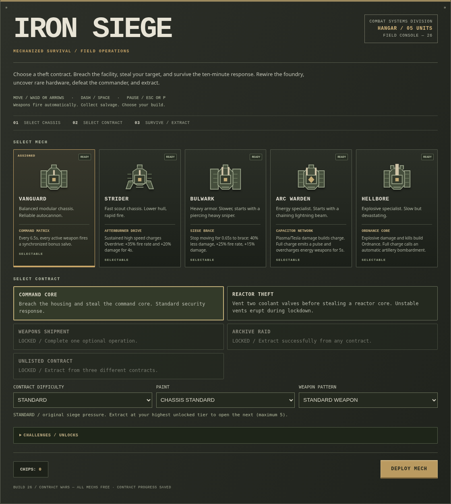

# IRON SIEGE

Choose a contract, breach a hostile foundry, and steal your target. Survive the lockdown, defeat the commander, and fight your way out.

**Latest: v26 — Contract Wars** · [Download the game package](downloads/iron_siege_v26.zip) · [What's new](CHANGELOG.md)

## Play

1. Open the [game package](downloads/iron_siege_v26.zip) and select **Download raw file** on GitHub.
2. Extract the ZIP.
3. Open `iron_siege_v26.html` in your browser.

No installation or build step is required. The package contains only the game and a short instruction file.

You can also download the [standalone HTML](current/iron_siege_v26.html) with **Download raw file** and open it directly. GitHub's file preview displays source code rather than running the game.

## Your mission

- Choose one of five mechs with its own starting weapon and chassis ability.
- Choose a theft contract: command core, reactor, weapons shipment, or archive data. Discover the hidden fifth contract through successful extractions.
- Collect salvage, upgrade your weapons, and find rare hardware that changes how your equipment works. Each run has two rare slots.
- Choose lasting production and power changes during the siege. Take on optional operations while the Warden directs the lockdown over the radio.
- Face different Warden configurations, breach the perimeter gate, and reach extraction.
- Complete challenges for weapon patterns, paint, and new contracts. Win to open five Escalation tiers for each contract.

## Controls and saves

**Keyboard:** WASD or arrow keys to move; Space to dash. Weapons aim and fire automatically.

**Touch:** Use the movement stick and DASH button.

Open **Pause** for settings, the field manual, and the intercept log. The log keeps complete radio messages if you miss a line during combat.

Progress is saved in your browser. Keep using the same browser and game location to continue your save; downloading the file on another device does not transfer progress.

## Updates

**v26 — Contract Wars** gives each run new goals. Start with Command Core or Reactor Theft; optional operations and extractions open more contracts. At 02:00 and 05:00, change how the factory responds. Rare equipment can add bankshot sniper rounds, charged ground, chained mines, dash mines, or rocket fragments.

The full-facility minimap, screen outline, operation markers, compact radio, and post-Warden breakout remain part of every run.

Read the [changelog](CHANGELOG.md) for recent additions. All earlier builds remain available in the [version archive](versions/README.md); v26 is the latest. Single-digit archive names use leading zeros so they sort in order.
