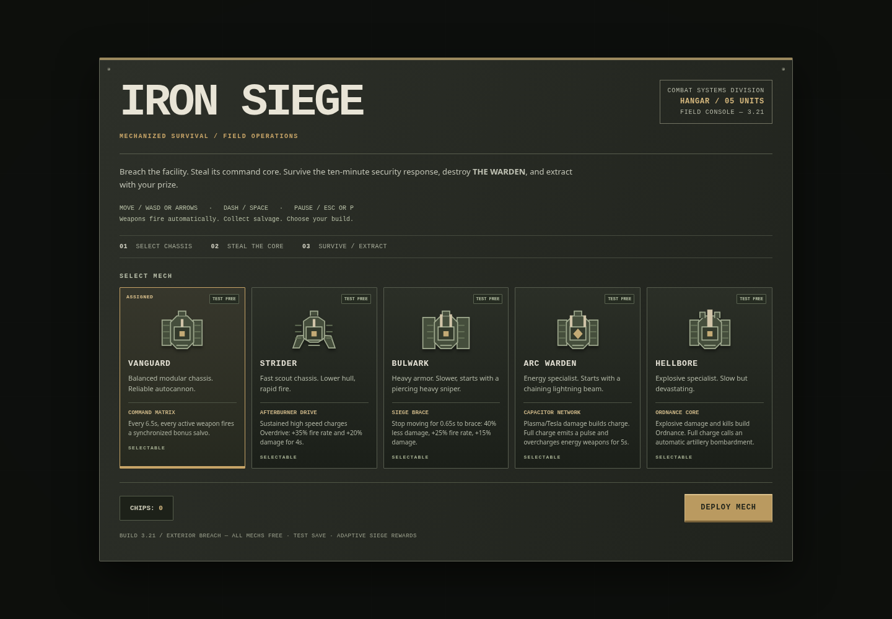

# IRON SIEGE

Breach a hostile foundry. Steal its core. Survive the lockdown, destroy the Warden, and fight your way out.

**Latest: v24 — Compact Radio** · [Download the game package](downloads/iron_siege_v24.zip) · [What's new](CHANGELOG.md)

## Play

1. Open the [game package](downloads/iron_siege_v24.zip) and select **Download raw file** on GitHub.
2. Extract the ZIP.
3. Open `iron_siege_v24.html` in your browser.

No installation or build step is required. The package contains only the game and a short instruction file.

You can also download the [standalone HTML](current/iron_siege_v24.html) with **Download raw file** and open it directly. GitHub's file preview displays source code rather than running the game.

## Your mission

- Choose one of five mechs with its own starting weapon and chassis ability.
- Break into the facility and steal the core to trigger the siege.
- Collect salvage and upgrade your weapons as security escalates.
- Take on optional operations while the Warden directs the lockdown over the radio.
- Defeat the Warden, breach the perimeter gate, and reach extraction.

## Controls and saves

**Keyboard:** WASD or arrow keys to move; Space to dash. Weapons aim and fire automatically.

**Touch:** Use the movement stick and DASH button.

Open **Pause** for settings, the field manual, and the intercept log. The log keeps complete radio messages if you miss a line during combat.

Progress is saved in your browser. Keep using the same browser and game location to continue your save; downloading the file on another device does not transfer progress.

## Updates

Read the [changelog](CHANGELOG.md) for recent additions. All earlier builds remain available in the [version archive](versions/README.md); v24 is the latest. Single-digit archive names use leading zeros so they sort in order.
